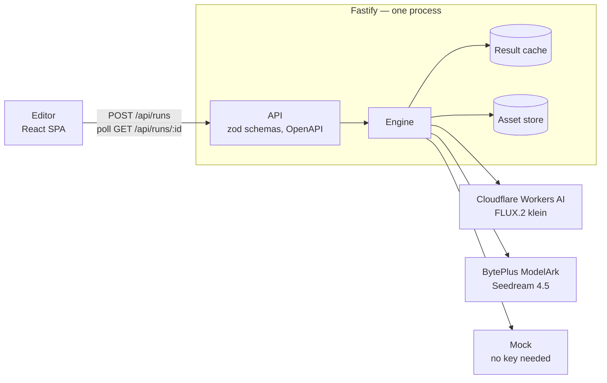

# Trafaret

[](https://github.com/aderiushev/trafaret/actions/workflows/ci.yml)

A node-based editor for reusable AI-image recipes. Put a prompt, a photo, _Generate Image_, _Edit Image_ and
_Result_ blocks on a canvas, wire them up, pick a style preset and press **Run**. Independent branches render at
the same time, a failed node can be retried on its own, and the next run regenerates only what changed — the rest
comes from a content-addressed cache, and a timeline shows it.

_Trafaret_ (трафарет) is Russian for _stencil_: cut it once, use it again and again.

## Run it locally — no keys needed

You need Node 24 and pnpm 10 (`corepack enable` picks the pnpm version pinned in `package.json`).

```bash
pnpm install
pnpm dev
```

Open `http://127.0.0.1:5173`. The editor talks to the API on port 8080 through Vite's proxy. The first visit opens
the "One prompt, two styles" workflow; press **Run** and both branches render on the Mock model, which draws the
prompt instead of calling an AI service.

### Real models

Copy `.env.example` to `.env`, fill in the keys of either provider and restart `pnpm dev`:

| Model           | Provider              | Variables                                       | Price                       |
| --------------- | --------------------- | ----------------------------------------------- | --------------------------- |
| FLUX.2 klein 4B | Cloudflare Workers AI | `CLOUDFLARE_ACCOUNT_ID`, `CLOUDFLARE_API_TOKEN` | free daily allowance        |
| Seedream 4.5    | BytePlus ModelArk     | `ARK_API_KEY`                                   | 200 free images, then $0.04 |

The keys stay on the server: no endpoint returns them and the logs redact them. A model without its key shows up
disabled, with the variable to set. Daily caps (`DAILY_LIMIT_CLOUDFLARE`, `DAILY_LIMIT_BYTEPLUS`) bound the spend;
past a cap a job runs on the Mock model and the editor labels the result as a fallback.

### The production build

One process serves the built editor and the API, as on the live demo:

```bash
docker build -t trafaret .
docker run --rm -p 8080:8080 trafaret    # add --env-file .env for the real models
```

Open `http://127.0.0.1:8080`. Without Docker: `pnpm build && pnpm --filter @trafaret/server start`.

## How it works



- **One graph, one set of rules.** A workflow is plain JSON. `packages/core` holds the node types, the wiring rule
  (`canConnect`: matching port types, one wire per input, no cycles) and `validateGraph`; the canvas and the server
  both use them, so they cannot disagree.
- **Dependency-driven scheduling.** Every node is a memoised promise that waits only for its own inputs, so
  independent branches overlap and a node starts the moment its inputs are ready — not level by level. A global
  semaphore caps concurrent provider calls.
- **Incremental runs.** A node's cache key hashes its type, its data, its preset and its inputs' keys (Nix/Bazel
  style), so every cache hit is known before the run starts. **Run** rebuilds only what changed; 🎲 _Regenerate_
  gives a node a new seed, so it and the nodes after it render again.
- **Failures stay local.** A failed node fails only its dependents (`UPSTREAM_FAILED`); sibling branches keep
  running. **Retry** re-runs the node, the failed nodes it depends on and the ones it blocked. Paid calls are never
  retried automatically.
- **Presets live on the server.** A node stores a preset id; the request builder merges the preset's prompt,
  negative prompt and reference images at run time, and the inspector shows exactly what was sent.

## Requirements

| ID  | Requirement                                                           | Where                                                                                                                                                                                                              |
| --- | --------------------------------------------------------------------- | ------------------------------------------------------------------------------------------------------------------------------------------------------------------------------------------------------------------ |
| R1  | Feature-Sliced Design frontend, no business logic in UI components    | [`apps/web/src`](apps/web/src) layers, checked by Steiger in `pnpm lint`                                                                                                                                           |
| R2  | Prompt → Generate Image → Result                                      | "Text → Image" in [templates.ts](apps/web/src/features/load-template/model/templates.ts)                                                                                                                           |
| R3  | Image Input → Edit Image → Result                                     | "Edit a photo" in [templates.ts](apps/web/src/features/load-template/model/templates.ts)                                                                                                                           |
| R4  | Branching: one prompt, two Generate nodes, two results                | "One prompt, two styles", the first-visit workflow; [branching.spec.ts](e2e/branching.spec.ts)                                                                                                                     |
| R5  | React Flow canvas: add, move, connect, delete, select, branch         | [workflow-canvas](apps/web/src/widgets/workflow-canvas)                                                                                                                                                            |
| R6  | Typed `text` / `image` ports; incompatible wires are blocked          | [connect.ts](packages/core/src/connect.ts)                                                                                                                                                                         |
| R7  | A graph with dependencies, branches and parallel runs, usable as data | [graph.ts](packages/core/src/graph.ts), [validate.ts](packages/core/src/validate.ts), [run-execution.ts](apps/server/src/engine/run-execution.ts), [examples/branching.json](examples/branching.json), `/api/docs` |
| R8  | A real image generation: browser → backend → AI API → result          | [cloudflare.ts](apps/server/src/providers/cloudflare.ts), [byteplus.ts](apps/server/src/providers/byteplus.ts)                                                                                                     |
| R9  | The API key never reaches the frontend                                | keys only in [config.ts](apps/server/src/config.ts); redacted by [logger.ts](apps/server/src/lib/logger.ts)                                                                                                        |
| R10 | Loading and error states, timeouts                                    | timeout in [node-executors.ts](apps/server/src/engine/node-executors.ts), error mapping in [http.ts](apps/server/src/providers/http.ts), statuses in [NodeShell.tsx](apps/web/src/entities/node/ui/NodeShell.tsx)  |
| R11 | Edit Image                                                            | both real models edit; [node-executors.ts](apps/server/src/engine/node-executors.ts)                                                                                                                               |
| R12 | Preset entity merged by a request builder                             | [preset.ts](packages/core/src/preset.ts), [presets](apps/server/library/presets), [request-builder.ts](apps/server/src/engine/request-builder.ts)                                                                  |
| R13 | Independent branches run at the same time                             | [run-execution.ts](apps/server/src/engine/run-execution.ts), [semaphore.ts](apps/server/src/lib/semaphore.ts), [branching.spec.ts](e2e/branching.spec.ts)                                                          |
| R14 | Job statuses; `POST /api/runs` → `runId`; `GET /api/runs/:runId`      | [run.ts](packages/core/src/run.ts), [routes.ts](apps/server/src/runs/routes.ts)                                                                                                                                    |
| R15 | Retry a failed node                                                   | `retry()` in [run-execution.ts](apps/server/src/engine/run-execution.ts), [retry.spec.ts](e2e/retry.spec.ts)                                                                                                       |
| R16 | Whatever is unfinished is described                                   | [Not done yet](#not-done-yet)                                                                                                                                                                                      |

## Decisions and trade-offs

- **Vite SPA + Fastify, not Next.js.** The editor is a client-only canvas, and the engine needs a long-lived process
  that keeps working after the HTTP response. One container serves both from one origin, so there is no CORS.
- **Polling, not server push.** The editor polls the active run every 700 ms; every snapshot carries a version, so
  an older one never replaces a newer one. SSE would save requests, at the cost of more moving parts.
- **Everything in memory, one instance.** Runs, uploaded images and the result cache live in the process — enough
  for a demo on a 512 MB free instance (assets are capped at 150 MB, outputs are WebP). A restart forgets them;
  Redis and object storage are the next step.
- **Guarded live demo.** Daily caps per provider with a labelled Mock fallback, and per-visitor rate limits keyed by
  the address Render's Cloudflare edge reports (`cf-connecting-ip`) — never by `X-Forwarded-For`, which a client
  can forge.
- **No build step for the server.** Node runs the TypeScript directly (type stripping); only the editor is bundled.

## Tests

- `pnpm test` — Vitest: the wiring rules and validation; the engine with a fake provider (overlapping branches,
  failure isolation, retry, cache hits and invalidation, timeouts, the concurrency cap); the request builder;
  provider adapters with a stubbed `fetch`; the API through Fastify's `inject`; the editor's store, timeline maths
  and components in jsdom.
- `pnpm e2e` — Playwright against its own Mock-mode server: both branches overlap in time, Retry recovers a failed
  node, changing one preset re-renders only its branch, and axe finds no WCAG 2.2 A/AA problems. The suite stops
  before any scenario if the server offers a real model. Run `pnpm exec playwright install chromium` once.
- CI runs lint (ESLint, Steiger, Prettier), typecheck, the unit tests, the build and the e2e suite on every push
  to `main` and every pull request, and builds and smoke-tests the Docker image.

## Use the API directly

A workflow is plain JSON, and the editor's Export writes exactly this request body. With `pnpm dev` running:

```bash
curl -s -X POST localhost:8080/api/runs -H 'content-type: application/json' -d @examples/branching.json
curl -s localhost:8080/api/runs/<runId>
```

The interactive API reference is at `http://localhost:8080/api/docs`.

## Not done yet

Run cancellation · server push (SSE or WebSocket) · persistent storage · accounts and multi-tenancy · undo/redo ·
a preset editor · more node types (remove background, resize, video) · translations · automatic retries of paid
calls (left out on purpose: every retry costs money).

## About

Built by Aleksei Deriushev with [Claude Code](https://claude.com/claude-code) as a pair programmer. The design
spec and the implementation plans are in [`docs/`](docs). MIT License.
