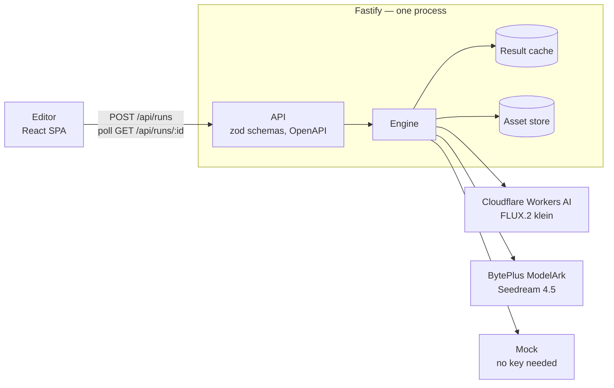

# Trafaret — Phase 3: Production Build, CI and Polish Implementation Plan

**Goal:** Make Trafaret ready to deploy and to show: the server serves the built editor, rate limits identify visitors correctly behind the demo host's edge, one Docker image runs everything, CI checks every push (with an accessibility scan and a guard against paid model calls), and the README explains the project.

**Architecture:** No new subsystems. Fastify gains `@fastify/static` for `apps/web/dist` (one origin, no CORS) and a `nosniff` header on every response. In production the rate-limit key becomes the address in `cf-connecting-ip` — set by Render's Cloudflare edge — grouped per IPv6 /64, and `trustProxy` goes away. A multi-stage Dockerfile installs the server's production dependencies in pnpm's workspace layout (Node refuses to strip types inside `node_modules`) and copies in the built editor. GitHub Actions runs the existing gates plus e2e and a Docker smoke test, and Render deploys `main` only after those checks pass.

**Tech Stack:** @fastify/static 10 · Docker (`node:24-slim`) · GitHub Actions (`actions/checkout@v7`, `pnpm/action-setup@v6`, `actions/setup-node@v7`, `actions/upload-artifact@v7`) · Render blueprint · @axe-core/playwright 4.13 · Playwright 1.64 project dependencies

**Spec:** `docs/specs/2026-10-08-trafaret-design.md` — mainly §7.6–7.8 (demo guards, configuration, security), §8.7 (accessibility), §9–12 (testing, CI, deployment, documentation). Phases 1 and 2 were built by `docs/plans/2026-10-08-trafaret-phase-1-core-and-server.md` and `docs/plans/2026-10-09-trafaret-phase-2-web-editor.md`.

## Roadmap

| Phase | Plan | Deliverable |
|---|---|---|
| 1 (done) | Core + server | API that runs workflows end to end, fully tested |
| 2 (done) | Web editor | FSD React app: canvas, typed wiring, run/poll, timeline, inspector, templates, Playwright e2e |
| **3 (this plan)** | Production build, CI and polish | Editor served by the server, edge-aware rate limits, Docker image, e2e guard, accessibility pass, CI + Render blueprint, README and spec |
| 4 | Go live | Real preset images and sample photo, the Render demo, live checks, README media, keep-warm workflow, portfolio page |

Phase 3 stops before going live on purpose: everything in it can be built and checked without accounts. Phase 4 needs provider keys and a Render account that only the owner can create (see the end of this plan).

## How this plan was made

Every file in this plan was built and run before the plan was written, in a scratch copy of `main`:

- `pnpm lint`, `pnpm typecheck` and `pnpm test` (365 → 378 tests) passed, and `pnpm e2e` (the mock-mode check plus four scenarios) passed four times in a row. Lint, typecheck, the unit tests and the build also passed under Node 24 (in a `node:24` container), the version CI and the image use.
- The Docker image was built and run: it serves the editor and the API, completes a Mock run with the prompt drawn in DejaVu Sans, runs as `node` on Node 24.21, and used 105 MiB of memory after a run (the demo host has 512 MB).
- Each new check was seen failing first: the mock-mode check stops the suite when a fake provider key reaches the server; the accessibility scan reports the contrast bug when the fix is reverted; the new web unit tests fail on the old components.
- The CI workflow and the Render blueprint cannot run before they are pushed. Their YAML passes Prettier, the CI smoke-test commands were run against a locally built image, and the field names follow Render's blueprint reference and the current inputs of the four GitHub actions.

Finally the plan itself was generated from those files and replayed on a fresh checkout of `main`; the result was byte-for-byte the scratch copy. Type the code as it is written. If a step does not behave as the plan says, stop and report it instead of improvising a fix.

## Global Constraints

- Node runs the repository's TypeScript natively (type stripping): Node ≥ 22.18 locally, Node 24 in CI and in the image (`.nvmrc`). pnpm `10.15.0` (the `packageManager` field). pnpm prints an "Unsupported engine" warning on Node 22 — that is expected.
- New dependencies, exactly: `@fastify/static` `^10.1.5` in `apps/server`, `@axe-core/playwright` `^4.13.0` as a root dev dependency. Nothing else is added.
- Tests never call a real, paid model. The e2e server gets every provider key blanked, and from Task 4 on a setup check stops the suite if the server offers any real model.
- Provider keys never enter the repository, the image or the logs: `.dockerignore` excludes `.env*`; `render.yaml` declares the keys with `sync: false`, so they live in Render's dashboard.
- Never name the company or quote the exercise's brief in committed files.
- Web code keeps Phase 2's rules: Feature-Sliced Design imports flow downward only, the React Compiler is on (no hand-written `useMemo` / `useCallback` / `memo`), CSS Modules and the design tokens.
- Accessibility: visible focus, labelled controls, `prefers-reduced-motion` respected; from Task 5 on, the e2e suite fails on any axe finding at WCAG 2.2 A/AA or best practice.
- Copy: English, terse, and it says how to recover.
- Conventional commits, at least one per task, straight on `main`. Do not push: pushing is the owner's call.
- The gate at the end of every task: `pnpm lint && pnpm typecheck && pnpm test`; tasks that touch the e2e suite also run `pnpm e2e`.

**Spec deltas introduced by this plan** (Task 7 writes them into the spec):

1. In production a visitor is the address in `cf-connecting-ip` (Render runs behind Cloudflare, which sets and overwrites it), grouped per IPv6 /64. `X-Forwarded-For` is never trusted — Render appends to whatever the client sent — so `trustProxy` is off.
2. Every response carries `X-Content-Type-Options: nosniff`.
3. E2E gains ④, an axe scan (WCAG 2.2 A/AA plus best practices) of the idle editor, a finished run and a failed node, and a setup check that stops the suite if the server offers any real model.
4. CI gains a second job that builds the Docker image and smoke-tests it.
5. The image keeps pnpm's workspace layout for the server's dependencies (Node won't strip types inside `node_modules`) and adds fontconfig + DejaVu fonts so the Mock model can draw text.
6. Render deploys a push to `main` only after its CI checks pass (`autoDeployTrigger: checksPass`).
7. Error toasts stay until dismissed; the timeline announces lost contact; a running card keeps a still ring under reduced motion; a failed timeline row says "Failed".
8. The spec drops the brief's title and time estimate.

## File map

```
trafaret/
├─ Dockerfile · .dockerignore     the image the live demo runs (Task 3)
├─ render.yaml                    Render blueprint (Task 6)
├─ .github/workflows/ci.yml       CI: checks + e2e, Docker smoke test (Task 6)
├─ package.json                   + @axe-core/playwright (Task 5)
├─ playwright.config.ts           + the mock-mode setup project (Task 4)
├─ e2e/                           + mock-mode.setup.ts (Task 4) · accessibility.spec.ts (Task 5)
├─ .env.example                   NODE_ENV comment (Task 2)
├─ README.md                      rewritten (Task 7)
├─ docs/specs/2026-10-08-trafaret-design.md   Phase 3 deltas, neutral wording (Task 7)
├─ packages/core/src/             wording of one comment and three test titles (Task 7)
├─ apps/server/
│  ├─ package.json                + @fastify/static (Task 1)
│  └─ src/                        main.ts · app.ts (+ test) · http/server.ts (+ test) ·
│                                 http/web-app.ts (+ test) · http/client-key.ts (+ test) · library test title
└─ apps/web/src/                  accessibility fixes: Button, WorkflowCanvas, EditorPage, RunTimeline, NodeShell, Toaster
```

## Commands used throughout

- One server test file: `pnpm exec vitest run --project @trafaret/server <path fragment>`
- One web test file: `pnpm exec vitest run --project @trafaret/web <path fragment>`
- Everything (the gate at the end of every task): `pnpm lint && pnpm typecheck && pnpm test`
- The browser suite: `pnpm e2e` (once per machine: `pnpm exec playwright install chromium`)
- Docker needs a running engine: `docker info --format '{{.ServerVersion}}'` must print a version. If it doesn't, start Docker Desktop and wait until it does.

---

### Task 1: The server serves the built editor

In production one process serves both the editor and the API, from one origin, so the browser needs no CORS (spec §4.4, §7.8, §11). `@fastify/static` serves `apps/web/dist`: Vite's content-hashed bundles in `/assets` may be cached for good, while `index.html` is revalidated on every visit so a new deploy reaches returning visitors at once. Unknown paths keep the JSON error envelope. While here, every response gets `X-Content-Type-Options: nosniff`, so a browser never second-guesses a declared content type — uploaded images included.

`main.ts` serves the editor whenever its build exists (always in the image; locally after `pnpm build`). `pnpm dev` is unaffected: Vite keeps serving the editor on port 5173.

**Files:**
- Modify: `apps/server/package.json` (through `pnpm add`)
- Create: `apps/server/src/http/web-app.ts`, `apps/server/src/http/web-app.test.ts`
- Modify: `apps/server/src/http/server.ts`, `apps/server/src/http/server.test.ts`, `apps/server/src/app.ts`, `apps/server/src/main.ts`

**Interfaces:**
- Produces: `registerWebApp(app: FastifyInstance, root: string): Promise<void>` in `http/web-app.ts`; `AppOptions.webRoot?: string` in `app.ts` (when set, `buildApp` serves the editor from that folder).

- [ ] **Step 1: Add the dependency**

```bash
pnpm --filter @trafaret/server add @fastify/static@^10.1.5
```

Expected: `apps/server/package.json` lists `"@fastify/static": "^10.1.5"` and `pnpm-lock.yaml` changes.

- [ ] **Step 2: Write the failing test**

Create `apps/server/src/http/web-app.test.ts`:

```ts
import { mkdir, mkdtemp, writeFile } from 'node:fs/promises';
import { tmpdir } from 'node:os';
import { join } from 'node:path';
import { pino } from 'pino';
import { describe, expect, it } from 'vitest';
import { createHttpServer } from './server.ts';
import { registerWebApp } from './web-app.ts';

async function setup() {
  const root = await mkdtemp(join(tmpdir(), 'trafaret-web-'));
  await mkdir(join(root, 'assets'));
  await writeFile(join(root, 'index.html'), '<!doctype html><title>Trafaret</title>');
  await writeFile(join(root, 'assets', 'index-3f2a1b.js'), 'console.log("editor")');
  await writeFile(join(root, 'favicon.svg'), '<svg xmlns="http://www.w3.org/2000/svg"/>');
  const app = await createHttpServer({ logger: pino({ level: 'silent' }) });
  await registerWebApp(app, root);
  return app;
}

describe('registerWebApp', () => {
  it('serves the editor at / and has browsers revalidate it', async () => {
    const app = await setup();
    const response = await app.inject({ method: 'GET', url: '/' });
    expect(response.statusCode).toBe(200);
    expect(response.headers['content-type']).toMatch(/^text\/html/);
    expect(response.headers['cache-control']).toBe('no-cache');
    expect(response.body).toContain('<title>Trafaret</title>');
  });

  it('lets browsers keep the content-hashed bundles', async () => {
    const app = await setup();
    const response = await app.inject({ method: 'GET', url: '/assets/index-3f2a1b.js' });
    expect(response.statusCode).toBe(200);
    expect(response.headers['cache-control']).toBe('public, max-age=31536000, immutable');
  });

  it('revalidates other files at the root', async () => {
    const app = await setup();
    const response = await app.inject({ method: 'GET', url: '/favicon.svg' });
    expect(response.statusCode).toBe(200);
    expect(response.headers['cache-control']).toBe('no-cache');
  });

  it('keeps answering unknown paths with the error envelope', async () => {
    const app = await setup();
    for (const url of ['/api/nope', '/nope.js']) {
      const response = await app.inject({ method: 'GET', url });
      expect(response.statusCode).toBe(404);
      expect(response.json()).toMatchObject({ error: { code: 'NOT_FOUND' } });
    }
  });

  it('still routes the API', async () => {
    const app = await setup();
    expect((await app.inject({ method: 'GET', url: '/api/health' })).json()).toEqual({ ok: true });
  });
});
```

- [ ] **Step 3: Run it to see it fail**

Run: `pnpm exec vitest run --project @trafaret/server web-app`
Expected: FAIL — the suite cannot load `./web-app.ts`.

- [ ] **Step 4: Write the implementation**

Create `apps/server/src/http/web-app.ts`:

```ts
import { join, sep } from 'node:path';
import fastifyStatic from '@fastify/static';
import type { FastifyInstance } from 'fastify';

/** Vite names the files in /assets after their content, so a browser may keep them for good. */
const IMMUTABLE = 'public, max-age=31536000, immutable';

/**
 * Serves the built editor from the API's origin, so production needs no CORS. index.html is revalidated on every
 * visit, so returning visitors get a new deploy straight away.
 */
export async function registerWebApp(app: FastifyInstance, root: string): Promise<void> {
  const bundles = join(root, 'assets') + sep;
  await app.register(fastifyStatic, {
    root,
    setHeaders: (reply, path) => {
      reply.header('cache-control', path.startsWith(bundles) ? IMMUTABLE : 'no-cache');
    },
  });
}
```

- [ ] **Step 5: Run it to see it pass**

Run: `pnpm exec vitest run --project @trafaret/server web-app`
Expected: PASS, 5 tests.

- [ ] **Step 6: Write the failing nosniff test**

In `apps/server/src/http/server.test.ts`, replace:

```ts
  it('serves the OpenAPI document', async () => {
```

with:

```ts
  it('tells browsers not to second-guess any content type', async () => {
    const app = await createHttpServer({ logger });
    for (const url of ['/api/health', '/api/nope']) {
      const response = await app.inject({ method: 'GET', url });
      expect(response.headers['x-content-type-options']).toBe('nosniff');
    }
  });

  it('serves the OpenAPI document', async () => {
```

Run: `pnpm exec vitest run --project @trafaret/server http/server`
Expected: FAIL — `expected undefined to be 'nosniff'`.

- [ ] **Step 7: Add the header to every response**

In `apps/server/src/http/server.ts`, replace:

```ts
    frameworkErrors: (error, _request, reply) => void sendUrlError(reply, error),
  });
  app.setValidatorCompiler(validatorCompiler);
```

with:

```ts
    frameworkErrors: (error, _request, reply) => void sendUrlError(reply, error),
  });
  // Browsers must take every response, uploaded images included, as the type it declares.
  app.addHook('onRequest', (_request, reply, done) => {
    reply.header('x-content-type-options', 'nosniff');
    done();
  });
  app.setValidatorCompiler(validatorCompiler);
```

Run: `pnpm exec vitest run --project @trafaret/server http/server`
Expected: PASS.

- [ ] **Step 8: Let the app serve the editor**

In `apps/server/src/app.ts`, replace:

```ts
import { createHttpServer } from './http/server.ts';
```

with:

```ts
import { createHttpServer } from './http/server.ts';
import { registerWebApp } from './http/web-app.ts';
```

In `apps/server/src/app.ts`, replace:

```ts
export type AppOptions = { rateLimits?: { runsPer10Minutes: number; uploadsPer10Minutes: number } };
```

with:

```ts
export type AppOptions = {
  rateLimits?: { runsPer10Minutes: number; uploadsPer10Minutes: number };
  /** The built editor (apps/web/dist). When set, the server serves it next to the API. */
  webRoot?: string;
};
```

In `apps/server/src/app.ts`, replace:

```ts
    runsPer10Minutes: limits.runsPer10Minutes,
  });
  return app;
```

with:

```ts
    runsPer10Minutes: limits.runsPer10Minutes,
  });
  if (options.webRoot) await registerWebApp(app, options.webRoot);
  return app;
```

Replace the whole of `apps/server/src/main.ts` with:

```ts
import { existsSync } from 'node:fs';
import { join } from 'node:path';
import { fileURLToPath } from 'node:url';
import { buildApp } from './app.ts';
import { loadConfig } from './config.ts';
import { createLogger } from './lib/logger.ts';
import { createServices } from './services.ts';

const config = loadConfig(process.env);
const logger = createLogger({ level: config.logLevel });
// The editor's production build, when it exists (`pnpm build`; always in the Docker image).
const webRoot = fileURLToPath(new URL('../../web/dist', import.meta.url));
const app = await buildApp(
  config,
  await createServices(config, logger),
  logger,
  existsSync(join(webRoot, 'index.html')) ? { webRoot } : {},
);

for (const signal of ['SIGINT', 'SIGTERM'] as const) {
  process.once(signal, () => {
    logger.info({ signal }, 'shutting down');
    void app.close().then(() => process.exit(0));
  });
}

await app.listen({ host: config.host, port: config.port });
```

- [ ] **Step 9: Try the production build by hand**

```bash
pnpm build
NODE_ENV=production HOST=127.0.0.1 PORT=8095 node apps/server/src/main.ts & SERVER_PID=$!
sleep 3
curl -s -D - -o /dev/null http://127.0.0.1:8095/ | grep -i -E '^HTTP|cache-control|x-content-type-options'
curl -s http://127.0.0.1:8095/nope; echo
kill $SERVER_PID
```

Expected:

```
HTTP/1.1 200 OK
x-content-type-options: nosniff
cache-control: no-cache
{"error":{"code":"NOT_FOUND","message":"Nothing at GET /nope."}}
```

(`pnpm build` writes `apps/web/dist`, which git ignores.)

- [ ] **Step 10: Run the gate**

Run: `pnpm lint && pnpm typecheck && pnpm test`
Expected: everything passes; 371 tests.

- [ ] **Step 11: Commit**

```bash
git add apps/server/package.json pnpm-lock.yaml apps/server/src/http/web-app.ts apps/server/src/http/web-app.test.ts apps/server/src/http/server.ts apps/server/src/http/server.test.ts apps/server/src/app.ts apps/server/src/main.ts
git commit -m "feat(server): serve the built editor next to the API"
```

---

### Task 2: Rate limits count real visitors behind the demo host's edge

The live demo's per-visitor limits (spec §7.6) must key on an address the visitor cannot forge. On Render, `X-Forwarded-For` cannot be trusted: Render appends to whatever the client sent, so its first entry is the client's own claim — and with `trustProxy: true`, Fastify's `request.ip` is exactly that entry. Render runs behind Cloudflare, which puts the connecting address in `cf-connecting-ip` and replaces any value a client sends. So in production the key is that header, grouped per IPv6 /64 (the block one subscriber usually holds) with `@fastify/rate-limit`'s own `normalizeIP`. A request without the header did not come through the edge and is keyed by its connecting address — all such requests share one allowance, which fails closed. `trustProxy` goes away; nothing else used it. The header's behaviour on the live host is checked again in Phase 4.

The daily budget (spec §7.6) still caps the spend if the limiter is ever bypassed; this task is about fairness between visitors.

**Files:**
- Create: `apps/server/src/http/client-key.ts`, `apps/server/src/http/client-key.test.ts`
- Modify: `apps/server/src/app.ts`, `apps/server/src/app.test.ts`, `apps/server/src/http/server.ts`, `.env.example`

**Interfaces:**
- Consumes: `normalizeIP(ip: string, ipv6Subnet?: number): string` from `@fastify/rate-limit` (11.2).
- Produces: `edgeClientKey(request: Pick<FastifyRequest, 'headers' | 'ip'>): string` in `http/client-key.ts`. `HttpServerOptions` loses `trustProxy`.

- [ ] **Step 1: Write the failing test**

Create `apps/server/src/http/client-key.test.ts`:

```ts
import { describe, expect, it } from 'vitest';
import { edgeClientKey } from './client-key.ts';

const request = (headers: Record<string, string>, ip = '10.0.0.5') => ({ headers, ip });

describe('edgeClientKey', () => {
  it('keys a request by the visitor address the edge reports', () => {
    expect(edgeClientKey(request({ 'cf-connecting-ip': '203.0.113.7' }))).toBe('203.0.113.7');
  });

  it('ignores X-Forwarded-For, which the client controls', () => {
    const spoofed = request({ 'cf-connecting-ip': '203.0.113.7', 'x-forwarded-for': '198.51.100.1' });
    expect(edgeClientKey(spoofed)).toBe('203.0.113.7');
  });

  it('falls back to the connecting address without the edge header', () => {
    expect(edgeClientKey(request({}))).toBe('10.0.0.5');
    expect(edgeClientKey(request({ 'cf-connecting-ip': '' }))).toBe('10.0.0.5');
  });

  it('counts IPv6 visitors per /64 block', () => {
    const a = edgeClientKey(request({ 'cf-connecting-ip': '2001:db8:1:2:aaaa::1' }));
    const b = edgeClientKey(request({ 'cf-connecting-ip': '2001:db8:1:2:bbbb::2' }));
    const other = edgeClientKey(request({ 'cf-connecting-ip': '2001:db8:1:3::1' }));
    expect(a).toBe(b);
    expect(other).not.toBe(a);
  });
});
```

Run: `pnpm exec vitest run --project @trafaret/server client-key`
Expected: FAIL — the suite cannot load `./client-key.ts`.

- [ ] **Step 2: Write the implementation**

Create `apps/server/src/http/client-key.ts`:

```ts
import { normalizeIP } from '@fastify/rate-limit';
import type { FastifyRequest } from 'fastify';

/**
 * Who a request comes from, for rate limiting behind the demo host's edge. Render runs behind Cloudflare, which
 * sets cf-connecting-ip to the visitor's address and replaces any value a client sends. X-Forwarded-For can't be
 * trusted there: Render appends to whatever the client wrote, so its first entry is the client's own claim.
 * A request without the header didn't come through the edge and is keyed by its connecting address. IPv6
 * addresses count per /64, the block one subscriber usually holds.
 */
export function edgeClientKey(request: Pick<FastifyRequest, 'headers' | 'ip'>): string {
  const visitor = request.headers['cf-connecting-ip'];
  return normalizeIP(typeof visitor === 'string' && visitor !== '' ? visitor : request.ip);
}
```

Run: `pnpm exec vitest run --project @trafaret/server client-key`
Expected: PASS, 4 tests.

- [ ] **Step 3: Pin the production wiring**

In `apps/server/src/app.test.ts`, replace:

```ts
        '/api/assets',
      ]),
    );
  });
});
```

with:

```ts
        '/api/assets',
      ]),
    );
  });

  it('in production, counts requests per visitor address from the edge, whatever X-Forwarded-For says', async () => {
    const config = loadConfig({ NODE_ENV: 'production', MOCK_LATENCY_MS: '0-5' });
    const logger = pino({ level: 'silent' });
    const app = await buildApp(config, await createServices(config, logger), logger, {
      rateLimits: { runsPer10Minutes: 2, uploadsPer10Minutes: 2 },
    });
    // An empty body fails validation, but the limiter has counted the request by then.
    const startRun = (headers: Record<string, string>) =>
      app.inject({ method: 'POST', url: '/api/runs', payload: {}, headers });

    const visitor = { 'cf-connecting-ip': '203.0.113.7' };
    expect((await startRun({ ...visitor, 'x-forwarded-for': '198.51.100.1' })).statusCode).toBe(400);
    expect((await startRun({ ...visitor, 'x-forwarded-for': '198.51.100.2' })).statusCode).toBe(400);
    expect((await startRun({ ...visitor, 'x-forwarded-for': '198.51.100.3' })).statusCode).toBe(429);
    expect((await startRun({ 'cf-connecting-ip': '203.0.113.8' })).statusCode).toBe(400);
  });
});
```

Run: `pnpm exec vitest run --project @trafaret/server app.test`
Expected: PASS, 2 tests. The new test passes before the switch too: the old key read the same header. It pins what the switch in Step 4 must keep.

- [ ] **Step 4: Switch the app to the edge key and drop `trustProxy`**

In `apps/server/src/app.ts`, replace:

```ts
import type { FastifyInstance, FastifyRequest } from 'fastify';
```

with:

```ts
import type { FastifyInstance } from 'fastify';
```

In `apps/server/src/app.ts`, replace:

```ts
import type { Config } from './config.ts';
```

with:

```ts
import type { Config } from './config.ts';
import { edgeClientKey } from './http/client-key.ts';
```

Delete the old key function:

In `apps/server/src/app.ts`, delete:

```ts

/** Behind the demo host's edge, the visitor's address arrives in cf-connecting-ip. */
const clientKey = (request: FastifyRequest): string => {
  const header = request.headers['cf-connecting-ip'];
  return typeof header === 'string' && header !== '' ? header : request.ip;
};
```

In `apps/server/src/app.ts`, replace:

```ts
  const app = await createHttpServer({
    logger,
    trustProxy: production,
    ...(production ? { rateLimitKey: clientKey } : {}),
  });
```

with:

```ts
  const app = await createHttpServer({ logger, ...(production ? { rateLimitKey: edgeClientKey } : {}) });
```

In `apps/server/src/http/server.ts`, replace:

```ts
export type HttpServerOptions = {
  logger: Logger;
  trustProxy?: boolean;
  /** Identifies a client for rate limiting; defaults to the request IP. */
```

with:

```ts
export type HttpServerOptions = {
  logger: Logger;
  /** Identifies a client for rate limiting; defaults to the connecting address. */
```

In `apps/server/src/http/server.ts`, replace:

```ts
    loggerInstance,
    trustProxy: options.trustProxy ?? false,
```

with:

```ts
    loggerInstance,
```

In `.env.example`, replace:

```bash
# development or production; production trusts the proxy and applies the demo rate limits per visitor IP.
```

with:

```bash
# development or production; production applies the demo rate limits per visitor, as the edge reports them.
```

- [ ] **Step 5: Run the server tests**

Run: `pnpm exec vitest run --project @trafaret/server app.test http`
Expected: PASS.

- [ ] **Step 6: Run the gate**

Run: `pnpm lint && pnpm typecheck && pnpm test`
Expected: everything passes; 376 tests.

- [ ] **Step 7: Commit**

```bash
git add apps/server/src/http/client-key.ts apps/server/src/http/client-key.test.ts apps/server/src/app.ts apps/server/src/app.test.ts apps/server/src/http/server.ts .env.example
git commit -m "fix(server): key rate limits by the edge's visitor address, never X-Forwarded-For"
```

---

### Task 3: The Docker image the live demo runs

One image for the demo (spec §11): Fastify serves the built editor and `/api`. The server runs its TypeScript as is, so only the editor has a build step. Two details matter:

- The server's production dependencies are installed with pnpm's workspace layout (`pnpm install --prod --filter @trafaret/server...`), so `@trafaret/core` stays a link to `packages/core/src`. Node refuses to strip types from files inside `node_modules`, which is where a flattened copy (`pnpm deploy`) would put it.
- `node:24-slim` has no fonts, and the Mock model draws the prompt as text. The runtime stage adds fontconfig and DejaVu.

`NODE_ENV=production` is set in the image (the production rate limits and the `0.0.0.0` listen address follow from it). Render injects `PORT`. `.dockerignore` keeps local `.env` files, dependencies and build output out of the build context.

**Files:**
- Create: `Dockerfile`, `.dockerignore`

- [ ] **Step 1: Write `.dockerignore`**

```text
# Never send local secrets, dependencies or build output into the image.
.env
.env.*
**/node_modules
**/dist
.git
.private
coverage
playwright-report
test-results
*.log
.DS_Store
```

- [ ] **Step 2: Write the `Dockerfile`**

```dockerfile
# The live demo's image: Fastify serves the built editor and /api from one origin.
# The server runs its TypeScript as is (Node strips the types), so only the editor has a build step.

FROM node:24-slim AS base
ENV COREPACK_ENABLE_DOWNLOAD_PROMPT=0
RUN corepack enable
WORKDIR /app
COPY package.json pnpm-lock.yaml pnpm-workspace.yaml ./
COPY apps/server/package.json apps/server/
COPY apps/web/package.json apps/web/
COPY packages/core/package.json packages/core/

FROM base AS build
RUN pnpm install --frozen-lockfile
COPY . .
RUN pnpm build

# The server's production dependencies, in the workspace layout: @trafaret/core stays a link to packages/core,
# because Node refuses to strip types from files inside node_modules.
FROM base AS deps
RUN pnpm install --frozen-lockfile --prod --filter @trafaret/server...

FROM node:24-slim
# The Mock model draws the prompt as text, which needs a font.
RUN apt-get update \
  && apt-get install -y --no-install-recommends fontconfig fonts-dejavu-core \
  && rm -rf /var/lib/apt/lists/*
WORKDIR /app
ENV NODE_ENV=production
COPY --from=deps /app/node_modules node_modules
COPY --from=deps /app/apps/server/node_modules apps/server/node_modules
COPY --from=deps /app/packages/core/node_modules packages/core/node_modules
COPY package.json ./
COPY packages/core/package.json packages/core/
COPY packages/core/src packages/core/src
COPY apps/server/package.json apps/server/
COPY apps/server/src apps/server/src
COPY apps/server/library apps/server/library
COPY --from=build /app/apps/web/dist apps/web/dist
USER node
EXPOSE 8080
CMD ["node", "apps/server/src/main.ts"]
```

- [ ] **Step 3: Build the image**

Run: `docker info --format '{{.ServerVersion}}' && docker build -t trafaret .`
Expected: a version number, then a build that ends with `naming to docker.io/library/trafaret`.

- [ ] **Step 4: Smoke-test the container**

```bash
docker run -d --name trafaret-check -p 127.0.0.1:8096:8080 -e MOCK_LATENCY_MS=200-400 trafaret
curl --retry 30 --retry-delay 1 --retry-all-errors -sf http://127.0.0.1:8096/api/health; echo
curl -s -o /dev/null -w '%{http_code} %{content_type}\n' http://127.0.0.1:8096/
RUN_ID=$(curl -s -X POST http://127.0.0.1:8096/api/runs -H 'content-type: application/json' -d @examples/branching.json | node -p 'JSON.parse(require("fs").readFileSync(0, "utf8")).runId')
sleep 3
curl -s http://127.0.0.1:8096/api/runs/$RUN_ID | node -p 'JSON.parse(require("fs").readFileSync(0, "utf8")).status'
docker exec trafaret-check sh -c 'id -un; node --version'
docker rm -f trafaret-check
```

Expected:

```
{"ok":true}
200 text/html; charset=utf-8
completed
node
v24.x.x
trafaret-check
```

- [ ] **Step 5: Run the gate**

Run: `pnpm lint && pnpm typecheck && pnpm test`
Expected: everything passes; 376 tests.

- [ ] **Step 6: Commit**

```bash
git add Dockerfile .dockerignore
git commit -m "build: add the Docker image the live demo runs"
```

---

### Task 4: The browser suite refuses to run unless the server offers mock models only

The e2e server already starts with every known provider key blanked. That protects only the three variable names in `playwright.config.ts`: a provider added later under a new variable, exported by the developer's shell, would let a scenario call a paid model. A Playwright setup project closes the gap. Every scenario depends on it, and it fails when `/api/catalog` lists an enabled model whose provider isn't `mock` — before any scenario runs. It goes through the editor's dev proxy (`baseURL`), so it needs no port of its own.

**Files:**
- Create: `e2e/mock-mode.setup.ts`
- Modify: `playwright.config.ts`

- [ ] **Step 1: Write the check**

Create `e2e/mock-mode.setup.ts`:

```ts
import { expect, test as setup } from '@playwright/test';

type CatalogModel = { id: string; provider: string; enabled: boolean };

// Every scenario depends on this check: if a provider key ever reaches the e2e server, nothing runs.
setup('the server offers mock models only', async ({ request }) => {
  const response = await request.get('/api/catalog');
  expect(response.ok()).toBe(true);
  const { models } = (await response.json()) as { models: CatalogModel[] };
  const real = models.filter((model) => model.enabled && model.provider !== 'mock').map((model) => model.id);
  expect(real, 'a real model is enabled — blank its key in playwright.config.ts').toEqual([]);
});
```

- [ ] **Step 2: Make every scenario depend on it**

In `playwright.config.ts`, replace:

```ts
  projects: [{ name: 'chromium', use: { ...devices['Desktop Chrome'] } }],
```

with:

```ts
  projects: [
    // Runs first; if the server could reach a real, paid model, the scenarios never start.
    { name: 'mock-mode', testMatch: 'mock-mode.setup.ts' },
    { name: 'chromium', use: { ...devices['Desktop Chrome'] }, dependencies: ['mock-mode'] },
  ],
```

- [ ] **Step 3: Run the suite**

Run: `pnpm e2e`
Expected: `4 passed` — `[mock-mode] … the server offers mock models only` first, then the three scenarios.

- [ ] **Step 4: See it stop the suite**

In `playwright.config.ts`, temporarily give the API server two fake values: `CLOUDFLARE_ACCOUNT_ID: 'fake-account'` and `CLOUDFLARE_API_TOKEN: 'fake-token'`. Run `pnpm e2e`.
Expected: `1 failed` (the mock-mode check: FLUX.2 klein is enabled) and `3 did not run`. Nothing reaches Cloudflare: no scenario starts.

Set both values back to `''`. `git diff playwright.config.ts` must show only the `projects` change from Step 2.

- [ ] **Step 5: Run the gate**

Run: `pnpm lint && pnpm typecheck && pnpm test`
Expected: everything passes; 376 tests.

- [ ] **Step 6: Commit**

```bash
git add e2e/mock-mode.setup.ts playwright.config.ts
git commit -m "test(e2e): refuse to run unless the server offers mock models only"
```

---

### Task 5: The accessibility pass

axe-core scans the editor in three states — idle, after a finished run with a node selected, and with a failed node — at WCAG 2.2 A/AA plus axe's best practices. The scratch run found three problems, fixed in the first commit:

| axe rule | Where | Fix |
|---|---|---|
| `color-contrast` | the ⌘↵ hint on the Run button: 3.93:1 at 70 % opacity on the accent | 85 % opacity: 5.1:1 on the accent, 6.0:1 on its hover shade |
| `heading-order` | the cards' `<h3>` came before any `<h2>` | a visually hidden `<h2>Workflow</h2>` at the top of the canvas |
| `scrollable-region-focusable` | the inspector scrolls but held nothing focusable | the `<aside>` gets `tabIndex={0}` and a label |

The second commit covers four problems a scanner cannot see. Each is pinned by a unit test or a style rule:

- An error toast now stays until dismissed (WCAG 2.2.1): it says how to recover, which takes time to read. Info toasts still fade after 6 s.
- The timeline's "Lost contact…" and "Couldn't load the last run…" lines are `role="alert"`, so screen readers announce them.
- A failed timeline row says "Failed" instead of a duration — red alone isn't enough (WCAG 1.4.1).
- With reduced motion the running card's pulse is gone, and its ring stays still instead of vanishing.

**Files:**
- Modify: `package.json`, `pnpm-lock.yaml` (through `pnpm add`)
- Create: `e2e/accessibility.spec.ts`
- Modify: `apps/web/src/shared/ui/button/Button.module.css`, `apps/web/src/widgets/workflow-canvas/ui/WorkflowCanvas.tsx`, `apps/web/src/widgets/workflow-canvas/ui/WorkflowCanvas.module.css`, `apps/web/src/pages/editor/ui/EditorPage.tsx`, `apps/web/src/widgets/run-timeline/ui/RunTimeline.tsx`, `apps/web/src/widgets/run-timeline/ui/RunTimeline.test.tsx`, `apps/web/src/entities/node/ui/NodeShell.module.css`, `apps/web/src/shared/ui/toast/Toaster.tsx`, `apps/web/src/shared/ui/toast/Toaster.test.tsx`

**Interfaces:**
- Consumes: `cards`, `openEditor`, `runButton`, `timeline` from `e2e/editor.ts`; the mock-mode setup project from Task 4.
- Note: import the builder by name, `import { AxeBuilder } from '@axe-core/playwright'`. The package's types are CommonJS, and under `nodenext` a default import is not constructable.

- [ ] **Step 1: Add axe for Playwright**

```bash
pnpm add -D -w @axe-core/playwright@^4.13.0
```

- [ ] **Step 2: Write the failing scan**

Create `e2e/accessibility.spec.ts`:

```ts
import { AxeBuilder } from '@axe-core/playwright';
import { expect, test, type Page } from '@playwright/test';
import { cards, openEditor, runButton, timeline } from './editor.ts';

/** axe's findings for WCAG 2.2 A and AA plus its best practices, one line per rule and the elements it flags. */
async function accessibilityProblems(page: Page): Promise<string[]> {
  const { violations } = await new AxeBuilder({ page })
    .withTags(['wcag2a', 'wcag2aa', 'wcag21a', 'wcag21aa', 'wcag22aa', 'best-practice'])
    .analyze();
  return violations.map(
    (rule) => `${rule.id}: ${rule.nodes.map((node) => node.target.join(' ')).join(', ')}`,
  );
}

test('the editor passes an accessibility scan when idle, after a run and with a failed node', async ({
  page,
}) => {
  page.on('dialog', (dialog) => void dialog.accept()); // "Replace the current workflow?"
  await openEditor(page);
  expect(await accessibilityProblems(page)).toEqual([]);

  // A finished run, with a node selected: the inspector shows the request it sent to the AI.
  await runButton(page).click();
  await expect(timeline(page)).toContainText('Completed');
  await cards(page, 'generateImage')
    .first()
    .click({ position: { x: 20, y: 12 } });
  expect(await accessibilityProblems(page)).toEqual([]);

  // A failed node: error messages, Retry buttons and a failed timeline row.
  await page.getByRole('combobox', { name: 'Load a template' }).selectOption('text-to-image');
  const generate = cards(page, 'generateImage');
  await generate.getByLabel('Model').selectOption('mock-fails-first');
  await runButton(page).click();
  await expect(generate.getByRole('alert')).toContainText('always fails its first attempt');
  expect(await accessibilityProblems(page)).toEqual([]);
});
```

- [ ] **Step 3: Run it to see it fail**

Run: `pnpm exec playwright test accessibility`
Expected: FAIL at the first scan with two findings (the CSS-module class hashes differ):

```
"color-contrast: ._primary_… > kbd",
"heading-order: article[aria-label=\"Prompt\"] > ._header_… > ._heading_… > h3",
```

- [ ] **Step 4: Fix the Run button's hint contrast**

In `apps/web/src/shared/ui/button/Button.module.css`, replace:

```css
.button kbd {
  font: 500 11px/1 var(--font-mono);
  opacity: 0.7;
}
```

with:

```css
.button kbd {
  font: 500 11px/1 var(--font-mono);
  opacity: 0.85;
}
```

- [ ] **Step 5: Give the canvas a heading**

In `apps/web/src/widgets/workflow-canvas/ui/WorkflowCanvas.tsx`, replace:

```tsx
    <div className={styles.canvas}>
      <ReactFlow<FlowNode, FlowEdge>
```

with:

```tsx
    <div className={styles.canvas}>
      <h2 className={styles.heading}>Workflow</h2>
      <ReactFlow<FlowNode, FlowEdge>
```

In `apps/web/src/widgets/workflow-canvas/ui/WorkflowCanvas.module.css`, replace:

```css
.canvas {
  position: relative;
  height: 100%;
  min-height: 0;
}
```

with:

```css
.canvas {
  position: relative;
  height: 100%;
  min-height: 0;
}

/* Read by screen readers only: the node cards' headings sit under it. */
.heading {
  position: absolute;
  width: 1px;
  height: 1px;
  overflow: hidden;
  clip-path: inset(50%);
  white-space: nowrap;
}
```

Run: `pnpm exec playwright test accessibility`
Expected: FAIL at the second scan with `scrollable-region-focusable: aside`.

- [ ] **Step 6: Let the keyboard reach the inspector**

In `apps/web/src/pages/editor/ui/EditorPage.tsx`, replace:

```tsx
        <aside className={styles.inspector}>
```

with:

```tsx
        {/* Focusable, so the keyboard can scroll it when its content runs long. */}
        <aside className={styles.inspector} aria-label="Inspector" tabIndex={0}>
```

Run: `pnpm exec playwright test accessibility`
Expected: PASS (`2 passed`: the mock-mode check and the scan).

- [ ] **Step 7: Commit the scan and its fixes**

```bash
git add package.json pnpm-lock.yaml e2e/accessibility.spec.ts apps/web/src/shared/ui/button/Button.module.css apps/web/src/widgets/workflow-canvas/ui/WorkflowCanvas.tsx apps/web/src/widgets/workflow-canvas/ui/WorkflowCanvas.module.css apps/web/src/pages/editor/ui/EditorPage.tsx
git commit -m "fix(web): pass an automated accessibility scan at WCAG 2.2 AA"
```

- [ ] **Step 8: Write the failing unit tests**

In `apps/web/src/shared/ui/toast/Toaster.test.tsx`, replace:

```tsx
  it('keeps at most three on screen', () => {
```

with:

```tsx
  it('keeps an error until it is dismissed', () => {
    vi.useFakeTimers();
    render(<Toaster />);
    act(() => toast.error("Couldn't read that file.", ['Choose the file again.']));
    act(() => {
      vi.advanceTimersByTime(60_000);
    });
    expect(screen.getByRole('alert')).toHaveTextContent("Couldn't read that file.");
  });

  it('keeps at most three on screen', () => {
```

Replace the whole of `apps/web/src/widgets/run-timeline/ui/RunTimeline.test.tsx` with:

```tsx
import { QueryClient, QueryClientProvider } from '@tanstack/react-query';
import { render, screen } from '@testing-library/react';
import { beforeEach, describe, expect, it } from 'vitest';
import type { Run } from '@trafaret/core';
import { branchingGraph, job, runSnapshot } from '@trafaret/core/testing';
import { catalogQuery } from '@/entities/catalog';
import { presetsQuery } from '@/entities/preset';
import { runQueryKey, useRunSession } from '@/entities/run';
import { ApiError } from '@/shared/api';
import { RunTimeline } from './RunTimeline';

const unreachable = new ApiError(0, 'NETWORK', "Can't reach the server.");

/** The timeline showing `snapshot`. After lost contact, polling has given up and the snapshot is the last it got. */
async function renderTimeline(snapshot?: Run, { lostContact = false } = {}) {
  const queryClient = new QueryClient();
  queryClient.setQueryData(catalogQuery.queryKey, []);
  queryClient.setQueryData(presetsQuery.queryKey, []);
  const queryKey = runQueryKey('run_test');
  if (snapshot) queryClient.setQueryData(queryKey, snapshot);
  if (lostContact) {
    await queryClient.prefetchQuery({ queryKey, queryFn: () => Promise.reject(unreachable), retry: false });
  }
  useRunSession.setState({ activeRunId: 'run_test', submittedGraph: branchingGraph() });
  return render(
    <QueryClientProvider client={queryClient}>
      <RunTimeline />
    </QueryClientProvider>,
  );
}

beforeEach(() => {
  useRunSession.setState({ activeRunId: null, submittedGraph: null });
});

describe('RunTimeline', () => {
  it('keeps the last snapshot when contact is lost, and says how to recover', async () => {
    const running = job('gen-b', { status: 'running', finishedAt: null });
    await renderTimeline(runSnapshot([job('gen-a'), running], { status: 'running', finishedAt: null }), {
      lostContact: true,
    });
    expect(screen.getByRole('alert')).toHaveTextContent(
      "Lost contact with the server: Can't reach the server. Run the workflow again — finished nodes are reused.",
    );
    expect(screen.getByText('Running')).toBeInTheDocument();
    expect(screen.getAllByRole('listitem')).toHaveLength(2);
  });

  it('says how to recover when not even a first snapshot arrived', async () => {
    await renderTimeline(undefined, { lostContact: true });
    expect(screen.getByRole('alert')).toHaveTextContent(
      "Couldn't load the last run: Can't reach the server. Run the workflow again — finished nodes are reused.",
    );
    expect(screen.queryByRole('listitem')).not.toBeInTheDocument();
  });

  it('names a failed call in words, not only in red', async () => {
    const declined = {
      code: 'INVALID_INPUT' as const,
      message: 'The model declined this prompt.',
      retryable: false,
    };
    await renderTimeline(
      runSnapshot([job('gen-a', { status: 'error', error: declined }), job('gen-b')], { status: 'failed' }),
    );
    const [failed, done] = screen.getAllByRole('listitem');
    expect(failed).toHaveTextContent('Failed');
    expect(done).toHaveTextContent('1.0 s');
  });
});
```

Run: `pnpm exec vitest run --project @trafaret/web Toaster RunTimeline`
Expected: FAIL, 4 tests — `keeps an error until it is dismissed`, `keeps the last snapshot when contact is lost, and says how to recover`, `says how to recover when not even a first snapshot arrived` (no element with the `alert` role) and `names a failed call in words, not only in red`.

- [ ] **Step 9: Announce lost contact and name failed rows**

In `apps/web/src/widgets/run-timeline/ui/RunTimeline.tsx`, replace:

```tsx
        <p className={styles.empty}>{message}</p>
```

with:

```tsx
        <p className={styles.empty} role={error ? 'alert' : undefined}>
          {message}
        </p>
```

In `apps/web/src/widgets/run-timeline/ui/RunTimeline.tsx`, replace:

```tsx
        <p className={styles.lostContact}>
```

with:

```tsx
        <p className={styles.lostContact} role="alert">
```

In `apps/web/src/widgets/run-timeline/ui/RunTimeline.tsx`, replace:

```tsx
          : duration === null
            ? JOB_STATUS_LABEL[bar.status]
```

with:

```tsx
          : duration === null || bar.status === 'error'
            ? JOB_STATUS_LABEL[bar.status]
```

- [ ] **Step 10: Keep errors until they are dismissed**

In `apps/web/src/shared/ui/toast/Toaster.tsx`, replace:

```tsx
const VISIBLE_MS = 6000;
```

with:

```tsx
/** How long an info toast stays. An error stays until dismissed: it says how to recover, which takes time to read. */
const VISIBLE_MS = 6000;
```

In `apps/web/src/shared/ui/toast/Toaster.tsx`, replace:

```tsx
  useEffect(() => {
    const timer = setTimeout(() => dismiss(toast.id), VISIBLE_MS);
    return () => clearTimeout(timer);
  }, [dismiss, toast.id]);
```

with:

```tsx
  useEffect(() => {
    if (toast.tone === 'error') return;
    const timer = setTimeout(() => dismiss(toast.id), VISIBLE_MS);
    return () => clearTimeout(timer);
  }, [dismiss, toast.id, toast.tone]);
```

- [ ] **Step 11: Keep a still ring under reduced motion**

In `apps/web/src/entities/node/ui/NodeShell.module.css`, replace:

```css
.error {
  border-color: var(--error);
}
```

with:

```css
/* Without the pulse, the ring stays still. */
@media (prefers-reduced-motion: reduce) {
  .running {
    box-shadow: 0 0 0 2px rgb(255 95 31 / 35%);
  }
}

.error {
  border-color: var(--error);
}
```

Run: `pnpm exec vitest run --project @trafaret/web Toaster RunTimeline`
Expected: PASS.

- [ ] **Step 12: Run the gate and the browser suite**

Run: `pnpm lint && pnpm typecheck && pnpm test && pnpm e2e`
Expected: everything passes; 378 tests; `5 passed` in the browser suite.

- [ ] **Step 13: Commit**

```bash
git add apps/web/src/widgets/run-timeline/ui/RunTimeline.tsx apps/web/src/widgets/run-timeline/ui/RunTimeline.test.tsx apps/web/src/shared/ui/toast/Toaster.tsx apps/web/src/shared/ui/toast/Toaster.test.tsx apps/web/src/entities/node/ui/NodeShell.module.css
git commit -m "fix(web): keep error toasts until dismissed and announce lost contact"
```

---

### Task 6: CI and the Render blueprint

CI (spec §10) runs on every push to `main` and on pull requests. One job runs the full gate, the build and the e2e suite on Node 24, with no secrets at all. A second job builds the Docker image and checks that it boots and serves both the editor and the API — the image Render will deploy. A newer push to the same branch cancels the older run.

The blueprint (spec §11) describes the demo: a free Docker web service in Frankfurt, with `/api/health` as the health check and the three provider keys declared `sync: false`, so Render asks for them once and keeps them in its dashboard. With `autoDeployTrigger: checksPass`, Render deploys a push to `main` only after its CI checks pass. Nothing is deployed before Phase 4 connects the repository to Render.

**Files:**
- Create: `.github/workflows/ci.yml`, `render.yaml`

- [ ] **Step 1: Write the workflow**

Create `.github/workflows/ci.yml`:

```yaml
name: CI

on:
  push:
    branches: [main]
  pull_request:

permissions:
  contents: read

# A newer push to the same branch makes the older run pointless.
concurrency:
  group: ci-${{ github.ref }}
  cancel-in-progress: true

jobs:
  check:
    name: Lint, test, build, e2e
    runs-on: ubuntu-latest
    timeout-minutes: 20
    steps:
      - uses: actions/checkout@v7
      - uses: pnpm/action-setup@v6
      - uses: actions/setup-node@v7
        with:
          node-version-file: .nvmrc
          cache: pnpm
      - run: pnpm install --frozen-lockfile
      - run: pnpm lint
      - run: pnpm typecheck
      - run: pnpm test
      - run: pnpm build
      - run: pnpm exec playwright install --with-deps chromium
      # Mock models only: the job has no provider keys, and the suite stops if the server reports a real model.
      - run: pnpm e2e
      - if: failure()
        uses: actions/upload-artifact@v7
        with:
          name: playwright-report
          path: playwright-report/
          retention-days: 7

  image:
    name: Docker image
    runs-on: ubuntu-latest
    timeout-minutes: 15
    steps:
      - uses: actions/checkout@v7
      - run: docker build -t trafaret .
      # The image the demo host deploys must boot and serve both the editor and the API.
      - name: Smoke test
        run: |
          docker run -d -p 8080:8080 trafaret
          curl --retry 30 --retry-delay 1 --retry-all-errors -sf http://127.0.0.1:8080/api/health
          curl -sf http://127.0.0.1:8080/ | grep -q '<div id="root">'
```

- [ ] **Step 2: Write the blueprint**

Create `render.yaml`:

```yaml
# The live demo on Render: one free Docker web service. Creating it from this blueprint (New → Blueprint) asks for
# the provider keys once; they live in Render's dashboard, never in the repository.
services:
  - type: web
    name: trafaret
    runtime: docker
    plan: free
    region: frankfurt
    healthCheckPath: /api/health
    # A push to main is deployed once its CI checks have passed.
    autoDeployTrigger: checksPass
    envVars:
      - key: CLOUDFLARE_ACCOUNT_ID
        sync: false
      - key: CLOUDFLARE_API_TOKEN
        sync: false
      - key: ARK_API_KEY
        sync: false
```

- [ ] **Step 3: Check the formatting**

Run: `pnpm exec prettier --check .github render.yaml`
Expected: `All matched files use Prettier code style!`

- [ ] **Step 4: Run the CI smoke test locally**

Port 8080 must be free (stop `pnpm dev` if it runs).

```bash
docker build -t trafaret .
docker run -d --name trafaret-smoke -p 8080:8080 trafaret
curl --retry 30 --retry-delay 1 --retry-all-errors -sf http://127.0.0.1:8080/api/health; echo
curl -sf http://127.0.0.1:8080/ | grep -q '<div id="root">' && echo 'editor ok'
docker rm -f trafaret-smoke
```

Expected: `{"ok":true}`, `editor ok`, `trafaret-smoke`.

- [ ] **Step 5: Run the gate**

Run: `pnpm lint && pnpm typecheck && pnpm test`
Expected: everything passes; 378 tests.

- [ ] **Step 6: Commit**

```bash
git add .github/workflows/ci.yml render.yaml
git commit -m "ci: check every push; deploy main on Render once the checks pass"
```

The workflow first runs on the next push to GitHub. Pushing a file under `.github/workflows/` needs a GitHub credential with the `workflow` scope.

---

### Task 7: The README and the spec

The README becomes the project's front page (spec §12): what Trafaret is, the one-minute local start, the real models, the production build, how it works (with a Mermaid diagram GitHub renders), the requirements R1–R16 linked to code, the decisions and trade-offs, the tests, the API, what is not done, and the CI badge. The live demo link, the GIF and screenshots come in Phase 4, once the demo exists.

The spec records the Phase 3 deltas listed at the top of this plan. It also drops the brief's title and time estimate. Test titles and comments that pointed at "the brief" now say what they check.

**Files:**
- Modify: `README.md`, `docs/specs/2026-10-08-trafaret-design.md`
- Modify (wording only): `apps/server/src/library/library.test.ts`, `packages/core/src/contracts.test.ts`, `packages/core/src/nodes.test.ts`, `packages/core/src/ports.test.ts`, `packages/core/src/preset.ts`, `packages/core/src/testing.ts`

- [ ] **Step 1: Rewrite the README**

Replace the whole of `README.md` with:

````markdown
# Trafaret

[](https://github.com/aderiushev/trafaret/actions/workflows/ci.yml)

A node-based editor for reusable AI-image recipes. Put a prompt, a photo, _Generate Image_, _Edit Image_ and
_Result_ blocks on a canvas, wire them up, pick a style preset and press **Run**. Independent branches render at
the same time, a failed node can be retried on its own, and the next run regenerates only what changed — the rest
comes from a content-addressed cache, and a timeline shows it.

_Trafaret_ (трафарет) is Russian for _stencil_: cut it once, use it again and again.

## Run it locally — no keys needed

You need Node 24 and pnpm 10 (`corepack enable` picks the pnpm version pinned in `package.json`).

```bash
pnpm install
pnpm dev
```

Open `http://127.0.0.1:5173`. The editor talks to the API on port 8080 through Vite's proxy. The first visit opens
the "One prompt, two styles" workflow; press **Run** and both branches render on the Mock model, which draws the
prompt instead of calling an AI service.

### Real models

Copy `.env.example` to `.env`, fill in the keys of either provider and restart `pnpm dev`:

| Model           | Provider              | Variables                                       | Price                       |
| --------------- | --------------------- | ----------------------------------------------- | --------------------------- |
| FLUX.2 klein 4B | Cloudflare Workers AI | `CLOUDFLARE_ACCOUNT_ID`, `CLOUDFLARE_API_TOKEN` | free daily allowance        |
| Seedream 4.5    | BytePlus ModelArk     | `ARK_API_KEY`                                   | 200 free images, then $0.04 |

The keys stay on the server: no endpoint returns them and the logs redact them. A model without its key shows up
disabled, with the variable to set. Daily caps (`DAILY_LIMIT_CLOUDFLARE`, `DAILY_LIMIT_BYTEPLUS`) bound the spend;
past a cap a job runs on the Mock model and the editor labels the result as a fallback.

### The production build

One process serves the built editor and the API, as on the live demo:

```bash
docker build -t trafaret .
docker run --rm -p 8080:8080 trafaret    # add --env-file .env for the real models
```

Open `http://127.0.0.1:8080`. Without Docker: `pnpm build && pnpm --filter @trafaret/server start`.

## How it works



- **One graph, one set of rules.** A workflow is plain JSON. `packages/core` holds the node types, the wiring rule
  (`canConnect`: matching port types, one wire per input, no cycles) and `validateGraph`; the canvas and the server
  both use them, so they cannot disagree.
- **Dependency-driven scheduling.** Every node is a memoised promise that waits only for its own inputs, so
  independent branches overlap and a node starts the moment its inputs are ready — not level by level. A global
  semaphore caps concurrent provider calls.
- **Incremental runs.** A node's cache key hashes its type, its data, its preset and its inputs' keys (Nix/Bazel
  style), so every cache hit is known before the run starts. **Run** rebuilds only what changed; 🎲 _Regenerate_
  gives a node a new seed, so it and the nodes after it render again.
- **Failures stay local.** A failed node fails only its dependents (`UPSTREAM_FAILED`); sibling branches keep
  running. **Retry** re-runs the node, the failed nodes it depends on and the ones it blocked. Paid calls are never
  retried automatically.
- **Presets live on the server.** A node stores a preset id; the request builder merges the preset's prompt,
  negative prompt and reference images at run time, and the inspector shows exactly what was sent.

## Requirements

| ID  | Requirement                                                           | Where                                                                                                                                                                                                              |
| --- | --------------------------------------------------------------------- | ------------------------------------------------------------------------------------------------------------------------------------------------------------------------------------------------------------------ |
| R1  | Feature-Sliced Design frontend, no business logic in UI components    | [`apps/web/src`](apps/web/src) layers, checked by Steiger in `pnpm lint`                                                                                                                                           |
| R2  | Prompt → Generate Image → Result                                      | "Text → Image" in [templates.ts](apps/web/src/features/load-template/model/templates.ts)                                                                                                                           |
| R3  | Image Input → Edit Image → Result                                     | "Edit a photo" in [templates.ts](apps/web/src/features/load-template/model/templates.ts)                                                                                                                           |
| R4  | Branching: one prompt, two Generate nodes, two results                | "One prompt, two styles", the first-visit workflow; [branching.spec.ts](e2e/branching.spec.ts)                                                                                                                     |
| R5  | React Flow canvas: add, move, connect, delete, select, branch         | [workflow-canvas](apps/web/src/widgets/workflow-canvas)                                                                                                                                                            |
| R6  | Typed `text` / `image` ports; incompatible wires are blocked          | [connect.ts](packages/core/src/connect.ts)                                                                                                                                                                         |
| R7  | A graph with dependencies, branches and parallel runs, usable as data | [graph.ts](packages/core/src/graph.ts), [validate.ts](packages/core/src/validate.ts), [run-execution.ts](apps/server/src/engine/run-execution.ts), [examples/branching.json](examples/branching.json), `/api/docs` |
| R8  | A real image generation: browser → backend → AI API → result          | [cloudflare.ts](apps/server/src/providers/cloudflare.ts), [byteplus.ts](apps/server/src/providers/byteplus.ts)                                                                                                     |
| R9  | The API key never reaches the frontend                                | keys only in [config.ts](apps/server/src/config.ts); redacted by [logger.ts](apps/server/src/lib/logger.ts)                                                                                                        |
| R10 | Loading and error states, timeouts                                    | timeout in [node-executors.ts](apps/server/src/engine/node-executors.ts), error mapping in [http.ts](apps/server/src/providers/http.ts), statuses in [NodeShell.tsx](apps/web/src/entities/node/ui/NodeShell.tsx)  |
| R11 | Edit Image                                                            | both real models edit; [node-executors.ts](apps/server/src/engine/node-executors.ts)                                                                                                                               |
| R12 | Preset entity merged by a request builder                             | [preset.ts](packages/core/src/preset.ts), [presets](apps/server/library/presets), [request-builder.ts](apps/server/src/engine/request-builder.ts)                                                                  |
| R13 | Independent branches run at the same time                             | [run-execution.ts](apps/server/src/engine/run-execution.ts), [semaphore.ts](apps/server/src/lib/semaphore.ts), [branching.spec.ts](e2e/branching.spec.ts)                                                          |
| R14 | Job statuses; `POST /api/runs` → `runId`; `GET /api/runs/:runId`      | [run.ts](packages/core/src/run.ts), [routes.ts](apps/server/src/runs/routes.ts)                                                                                                                                    |
| R15 | Retry a failed node                                                   | `retry()` in [run-execution.ts](apps/server/src/engine/run-execution.ts), [retry.spec.ts](e2e/retry.spec.ts)                                                                                                       |
| R16 | Whatever is unfinished is described                                   | [Not done yet](#not-done-yet)                                                                                                                                                                                      |

## Decisions and trade-offs

- **Vite SPA + Fastify, not Next.js.** The editor is a client-only canvas, and the engine needs a long-lived process
  that keeps working after the HTTP response. One container serves both from one origin, so there is no CORS.
- **Polling, not server push.** The editor polls the active run every 700 ms; every snapshot carries a version, so
  an older one never replaces a newer one. SSE would save requests, at the cost of more moving parts.
- **Everything in memory, one instance.** Runs, uploaded images and the result cache live in the process — enough
  for a demo on a 512 MB free instance (assets are capped at 150 MB, outputs are WebP). A restart forgets them;
  Redis and object storage are the next step.
- **Guarded live demo.** Daily caps per provider with a labelled Mock fallback, and per-visitor rate limits keyed by
  the address Render's Cloudflare edge reports (`cf-connecting-ip`) — never by `X-Forwarded-For`, which a client
  can forge.
- **No build step for the server.** Node runs the TypeScript directly (type stripping); only the editor is bundled.

## Tests

- `pnpm test` — Vitest: the wiring rules and validation; the engine with a fake provider (overlapping branches,
  failure isolation, retry, cache hits and invalidation, timeouts, the concurrency cap); the request builder;
  provider adapters with a stubbed `fetch`; the API through Fastify's `inject`; the editor's store, timeline maths
  and components in jsdom.
- `pnpm e2e` — Playwright against its own Mock-mode server: both branches overlap in time, Retry recovers a failed
  node, changing one preset re-renders only its branch, and axe finds no WCAG 2.2 A/AA problems. The suite stops
  before any scenario if the server offers a real model. Run `pnpm exec playwright install chromium` once.
- CI runs lint (ESLint, Steiger, Prettier), typecheck, the unit tests, the build and the e2e suite on every push,
  and builds and smoke-tests the Docker image.

## Use the API directly

A workflow is plain JSON, and the editor's Export writes exactly this request body. With `pnpm dev` running:

```bash
curl -s -X POST localhost:8080/api/runs -H 'content-type: application/json' -d @examples/branching.json
curl -s localhost:8080/api/runs/<runId>
```

The interactive API reference is at `http://localhost:8080/api/docs`.

## Not done yet

Run cancellation · server push (SSE or WebSocket) · persistent storage · accounts and multi-tenancy · undo/redo ·
a preset editor · more node types (remove background, resize, video) · translations · automatic retries of paid
calls (left out on purpose: every retry costs money).

## About

Built by Aleksei Deriushev. The design spec and the implementation plans are in [`docs/`](docs). MIT License.
````

Run: `pnpm exec prettier --check README.md`
Expected: `All matched files use Prettier code style!`

- [ ] **Step 2: Record Phase 3 in the spec**

In `docs/specs/2026-10-08-trafaret-design.md`, replace:

```markdown
- **Status:** Approved in design review; awaiting written-spec review
```

with:

```markdown
- **Status:** Approved; built phase by phase from the plans in `docs/plans/`
```

In `docs/specs/2026-10-08-trafaret-design.md`, replace the three-line paragraph of §1 that begins "The project answers a take-home brief" with:

```markdown
The project started as a take-home exercise: a small node-based editor plus at least one real AI image generation
through a backend, testing frontend, backend, AI-API integration and the understanding of graph execution. It is also
a public portfolio piece.
```

In `docs/specs/2026-10-08-trafaret-design.md`, replace:

```markdown
1. Satisfy every requirement of the brief (traceability in §3).
```

with:

```markdown
1. Satisfy every requirement of the exercise (traceability in §3).
```

In the §3 table header:

In `docs/specs/2026-10-08-trafaret-design.md`, replace:

```markdown
| ID  | Requirement (from the brief)                                                                                                  |
```

with:

```markdown
| ID  | Requirement (from the exercise)                                                                                               |
```

In the §4.1 layout:

In `docs/specs/2026-10-08-trafaret-design.md`, replace:

```markdown
├─ Dockerfile      one image: Fastify serves the built SPA and /api
```

with:

```markdown
├─ .github/        CI workflow
├─ Dockerfile      one image: Fastify serves the built SPA and /api
```

In §7.6:

In `docs/specs/2026-10-08-trafaret-design.md`, replace:

```markdown
- `@fastify/rate-limit` per IP: runs + retries 20 per 10 min; uploads 30 per 10 min. `trustProxy` in production.
```

with:

```markdown
- `@fastify/rate-limit` per visitor: runs + retries 20 per 10 min; uploads 30 per 10 min. In production a visitor is
  the address in `cf-connecting-ip`, which Render's Cloudflare edge sets and overwrites. `X-Forwarded-For` is never
  trusted — Render appends to whatever the client sent — and IPv6 addresses count per /64. A request without the
  header is keyed by its connecting address.
```

In §7.7:

In `docs/specs/2026-10-08-trafaret-design.md`, replace:

```markdown
A malformed one (spaces or control characters) stops the boot with the variable's name, never its value.
```

with:

```markdown
A malformed one (anything but printable ASCII without spaces) stops the boot with the variable's name, never its value.
```

In `docs/specs/2026-10-08-trafaret-design.md`, replace:

```markdown
| `NODE_ENV`                                        | `development` | `production` turns on `trustProxy` and the production rate limits, keyed by the edge's `cf-connecting-ip` (§7.6) |
```

with:

```markdown
| `NODE_ENV`                                        | `development` | `production` turns on the production rate limits, keyed by the edge's `cf-connecting-ip` (§7.6)                  |
```

In `docs/specs/2026-10-08-trafaret-design.md`, replace:

```markdown
| `MOCK_LATENCY_MS`                                 | `1200-3500`   | mock latency range (tests use `0-20`)                                                                            |
```

with:

```markdown
| `MOCK_LATENCY_MS`                                 | `1200-3500`   | mock latency range (server tests use a few ms, e2e `800-1200`)                                                   |
```

In §7.8:

In `docs/specs/2026-10-08-trafaret-design.md`, replace:

```markdown
- The SPA and API share an origin: no CORS in production, a Vite proxy in development.
```

with:

```markdown
- The SPA and API share an origin: no CORS in production, a Vite proxy in development. Every response carries
  `X-Content-Type-Options: nosniff`.
```

In §8.7:

In `docs/specs/2026-10-08-trafaret-design.md`, replace:

```markdown
- Visible focus states, labelled icon buttons, `prefers-reduced-motion` respected. Desktop-first; on narrow
  screens the canvas stays viewable and runnable.
```

with:

```markdown
- Visible focus states, labelled icon buttons, `prefers-reduced-motion` respected (a running card keeps a still
  ring). Error toasts stay until dismissed; the timeline announces lost contact. Desktop-first; on narrow screens the
  canvas stays viewable and runnable.
```

In §9:

In `docs/specs/2026-10-08-trafaret-design.md`, replace:

```markdown
| E2E (Playwright, server in mock mode)                             | ① template 3 → Run → both results appear and the timeline bars overlap; ② "fails first attempt" model → error → Retry → success; ③ change only Generate B's preset → Run → A shows ⚡ reused — on its own ports (API 8090, editor 5174) with every provider key blanked |
```

with:

```markdown
| E2E (Playwright, server in mock mode)                             | ① template 3 → Run → both results appear and the timeline bars overlap; ② "fails first attempt" model → error → Retry → success; ③ change only Generate B's preset → Run → A shows ⚡ reused; ④ axe finds no WCAG 2.2 A/AA or best-practice problems in the idle editor, after a run and with a failed node. All on their own ports (API 8090, editor 5174) with every provider key blanked; a setup check stops the suite if the server offers any real model |
```

In §10:

In `docs/specs/2026-10-08-trafaret-design.md`, replace:

```markdown
- GitHub Actions on push and pull request: install (pnpm cache) → lint → typecheck → test → build → e2e (Chromium,
  mock mode, no secrets).
```

with:

```markdown
- GitHub Actions on push and pull request: install (pnpm cache) → lint → typecheck → test → build → e2e (Chromium,
  mock mode, no secrets); a second job builds the Docker image and smoke-tests it (health check, editor).
```

In §11:

In `docs/specs/2026-10-08-trafaret-design.md`, replace:

```markdown
- Multi-stage Dockerfile → `node:24-slim`, production dependencies only, non-root user. Fastify serves
  `apps/web/dist` and `/api`; `GET /api/health` is the health check.
```

with:

```markdown
- Multi-stage Dockerfile → `node:24-slim`, production dependencies only, non-root user. Fastify serves
  `apps/web/dist` and `/api`; `GET /api/health` is the health check. The server's TypeScript runs as is (type
  stripping); its dependencies keep pnpm's workspace layout, because Node refuses to strip types inside
  `node_modules`. The runtime image adds fontconfig and DejaVu fonts for the Mock model's text.
```

In `docs/specs/2026-10-08-trafaret-design.md`, replace:

```markdown
  `healthCheckPath: /api/health`, auto-deploy on every push to `main`, provider keys as dashboard secrets
  (`sync: false`). Render runs exactly one instance, which the in-memory design requires, and does not throttle
  background work between requests.
```

with:

```markdown
  `healthCheckPath: /api/health`, auto-deploy of every push to `main` once its CI checks pass
  (`autoDeployTrigger: checksPass`), provider keys as dashboard secrets (`sync: false`). Render runs exactly one
  instance, which the in-memory design requires, and does not throttle background work between requests.
```

In §13:

In `docs/specs/2026-10-08-trafaret-design.md`, replace the first cell of the §13 row whose risk begins "Scope creep" (keep the padding, so the column stays aligned) with:

```markdown
| Scope creep                                            |
```

Run: `grep -n -i -E 'brief|trustProxy' docs/specs/2026-10-08-trafaret-design.md`
Expected: no output.

- [ ] **Step 3: Commit the docs**

```bash
git add README.md docs/specs/2026-10-08-trafaret-design.md
git commit -m "docs: rewrite the README; record Phase 3 in the spec"
```

- [ ] **Step 4: Word the tests and comments without the brief**

In `apps/server/src/library/library.test.ts`, replace:

```ts
  it("loads presets in the brief's shape and pins their reference images", async () => {
```

with:

```ts
  it('loads every preset file and pins its reference images', async () => {
```

In `packages/core/src/contracts.test.ts`, replace:

```ts
  it("accepts a preset in exactly the brief's shape", () => {
```

with:

```ts
  it('accepts a preset of id, name, mainPrompt, negativePrompt and references', () => {
```

In `packages/core/src/nodes.test.ts`, replace:

```ts
  it('defines exactly the five node types from the brief', () => {
```

with:

```ts
  it('defines exactly the five node types', () => {
```

In `packages/core/src/ports.test.ts`, replace:

```ts
  it('has exactly the two port types from the brief', () => {
```

with:

```ts
  it('has exactly two port types, text and image', () => {
```

In `packages/core/src/preset.ts`, replace:

```ts
/** Exactly the brief's shape. The API serves `references` as asset URLs. */
```

with:

```ts
/** A style preset, merged into AI requests by the server. The API serves `references` as asset URLs. */
```

In `packages/core/src/testing.ts`, replace:

```ts
/** Prompt → Generate A / Generate B → Result A / Result B — the brief's mandatory branching scenario. */
```

with:

```ts
/** Prompt → Generate A / Generate B → Result A / Result B — the branching scenario (R4). */
```

Run: `git grep -n -i brief -- . ':!docs/plans' ':!pnpm-lock.yaml'`
Expected: no output. (The plans in `docs/plans/` are a historical record and stay as they are.)

- [ ] **Step 5: Run the gate**

Run: `pnpm lint && pnpm typecheck && pnpm test`
Expected: everything passes; 378 tests.

- [ ] **Step 6: Commit**

```bash
git add apps/server/src/library/library.test.ts packages/core/src/contracts.test.ts packages/core/src/nodes.test.ts packages/core/src/ports.test.ts packages/core/src/preset.ts packages/core/src/testing.ts
git commit -m "chore: describe tests and comments without referring to the brief"
```

---

## After this plan: Phase 4, going live

Phase 4 gets its own plan once these exist. Only the owner can create them:

1. **Accounts and keys** — a Cloudflare account with a Workers AI API token and its account ID; a BytePlus ModelArk API key (`ARK_API_KEY`); a Render account linked to GitHub. The keys go into a local `.env` and, later, into Render's dashboard — never into the repository or a chat.
2. **A GitHub credential with the `workflow` scope** on the owner's machine, so the CI workflow can be pushed (`gh auth refresh -s workflow`, or a token that has it).

Then Phase 4 covers:

- Real preset reference images and the sample product photo, generated with FLUX.2 klein through the project's own provider adapter and committed as WebP ≤ 200 KB. This replaces `apps/server/scripts/make-placeholder-assets.ts`.
- The demo: Render → New → Blueprint → this repository → enter the three keys → deploy.
- Live checks: health, the catalog showing the real models, one real run, and — the identity gate — that forged `cf-connecting-ip` and `X-Forwarded-For` headers do not reset `x-ratelimit-remaining` on `POST /api/runs`.
- README media: the demo link, a GIF of "change one preset → only one branch re-renders" and screenshots; the keep-warm workflow (it needs the demo URL).
- The portfolio page `aderiushev.github.io/trafaret/` and card #15 "TF".

## Execution notes

The plan was executed task by task, each task reviewed on its own and the whole branch reviewed at the end. These
changes came out of the reviews, so the code differs from this plan's blocks in these places:

- Task 1 (`cb64256`): `@fastify/static` is registered with `wildcard: false` — its default catch-all route turned
  the router's 414 for an over-long id into a 404 — with a test that pins the 414; `sendUrlError` sets the nosniff
  header itself, because Fastify answers router errors without running the onRequest hook, and `/api/%zz` joined
  the nosniff test.
- Task 4 (`3842325`): the mock-mode check first asserts that it sees the Mock model enabled, so a renamed catalog
  field cannot make it pass without checking anything.
- Task 5 (`74cea95`): the focusable inspector draws its focus ring inside its edge (`outline-offset: -2px`); its
  neighbours hid an outer ring.
- Task 7 (`fbf7e46`, `0ec3add`): the spec says API responses, error envelopes and the editor's files carry nosniff
  (Node's own low-level replies don't); the README's CI line names the workflow's triggers (pushes to `main`, pull
  requests); the README's real-models Docker command adds `-e NODE_ENV=production`, because a `.env` copied from
  `.env.example` would switch the image to development and bind it to 127.0.0.1 inside the container; spec §8.5
  records that a failed timeline row says "Failed".
- Final review (`348e324`..`70fb2cc`): a repeated error toast replaces the earlier one, and starting a run clears
  error toasts (spec §8.7); the CI smoke test names its container, shows curl's errors and prints the server log
  when it fails; `.dockerignore` keeps env and log files out at any depth; the README diagram says `:runId`; the
  accessibility scan asserts what each scan covers; a test pins that without the edge header `X-Forwarded-For`
  never changes the rate-limit key; the mock-mode check's assertions say why they failed.
- Counts at the end: 381 unit tests (the plan's gates said 371 → 378; each review fix added its tests), and the
  browser suite reports `5 passed`.
